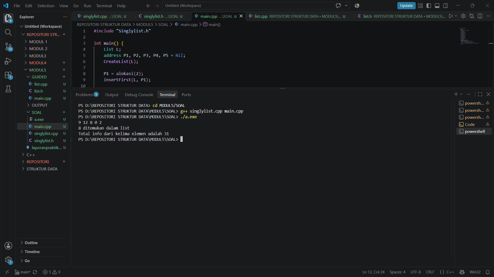

# <h1 align="center">Laporan Praktikum Modul 6 - Codeblocks IDE & Pengenalan Bahas C++ (Bagian Pertama)</h1>

<p align="center">ALIF RIZKI PANGESTU - 109082530004</p>

## Dasar Teori

### A. Konsep Doubly Linked List <br>

Doubly linked list adalah linked list yang setiap elemennya punya dua penunjuk, yaitu next ke elemen sesudahnya dan prev ke elemen sebelumnya, sehingga list bisa dijelajahi maju dan mundur. Setiap elemen terdiri dari info sebagai tempat data, next, dan prev. Sementara itu, list punya dua pointer utama, yaitu first yang menunjuk elemen pertama dan last yang menunjuk elemen terakhir. List dianggap kosong kalau first bernilai Nil.

### B. ADT Doubly Linked List <br>

ADT dibagi menjadi dua file, yaitu file .h yang berisi tipe data dan prototipe fungsi, serta file .cpp yang berisi isi fungsinya. Pada latihan, data yang disimpan adalah data kendaraan berupa nopol, warna, dan thnBuat. Fungsi dasarnya antara lain createList untuk membuat list kosong, alokasi untuk membuat elemen baru dengan new, dealokasi untuk menghapus elemen dari memori dengan delete, dan printInfo untuk menampilkan semua isi list dari first sampai Nil.

### C. Insert dan Delete <br>

Pada insert first, elemen baru disambungkan ke first yang lama, lalu first dipindah ke elemen baru. Pada insert last, elemen baru disambungkan ke last yang lama, lalu last dipindah ke elemen baru. Insert after dan insert before menyisipkan elemen di sesudah atau sebelum elemen tertentu, dan keduanya mirip, bedanya hanya pada pencarian elemennya.

Untuk penghapusan, delete first melepas elemen pertama lalu memindahkan first ke elemen berikutnya, sedangkan delete last melepas elemen terakhir lalu memindahkan last ke elemen sebelumnya. Delete after dan delete before melepas elemen di sesudah atau sebelum elemen tertentu, lalu elemen di kiri dan kanannya disambungkan langsung. Elemen yang sudah dilepas harus didealokasi supaya memorinya kembali ke sistem.

### D. Searching, Update, dan View <br>

Searching dilakukan dengan menelusuri list dari first, membandingkan info setiap elemen, lalu mengembalikan alamat elemen yang cocok atau Nil kalau tidak ditemukan. Proses update dan view caranya sama seperti pada singly linked list, hanya saja lebih mudah karena elemen bisa diakses maju dan mundur.

### E. Penerapan pada Latihan Modul <br>

Latihan ini membuat ADT doubly linked list untuk data kendaraan. Pengguna memasukkan empat data kendaraan, dan sebelum disisipkan, nomor polisinya dicek dengan findElm. Kalau sudah ada, data ditolak dengan pesan “nomor polisi sudah terdaftar”. Data yang diterima disisipkan dengan insertFirst, sehingga urutan tampilnya terbalik dari urutan input, yaitu data yang terakhir diinput muncul paling atas. Setelah itu, pengguna mencari satu nomor polisi dengan findElm dan datanya ditampilkan kalau ditemukan. Terakhir, pengguna menghapus satu data berdasarkan nomor polisi. Elemen dicari dulu, lalu dipakai deleteFirst kalau berada di awal, deleteLast kalau di akhir, dan deleteAfter lewat elemen prev-nya kalau di tengah. Setelah dihapus, elemen didealokasi dan isi list ditampilkan kembali.

## Guided

### 1. listmakanan.h

```C++
#ifndef LISTMAKANAN_H
#define LISTMAKANAN_H
#define Nil NULL

#include <iostream>
using namespace std;

struct makanan
{
    string nama;
    string jenis;
    float harga;
    float rating;
};

typedef makanan dataMakanan;

typedef struct node *address;

struct node
{
    dataMakanan isidata;
    address next;
    address prev;
};

struct linkedlist
{
    address first;
    address last;
};

bool isEmpty(linkedlist List);
void createList(linkedlist &List);
address alokasi(string nama, string jenis, float harga, float rating);
void dealokasi(address &node);

void insertFirst(linkedlist &List, address nodeBaru);
void insertLast(linkedlist &List, address nodeBaru);
void insertAfter(linkedlist &List, address nodeBaru, address Prev);
void insertBefore(linkedlist &List, address nodeBaru, address nodeNext);

void printList(linkedlist List);

void updateFirst(linkedlist List);
void updateLast(linkedlist List);
void updateAfter(linkedlist List, address prev);
void updateBefore(linkedlist List, address nodeNext);

// Searching
void findByName(linkedlist List, string nama);
void findByJenis(linkedlist List, string jenis);
void findByMinRating(linkedlist List, float minRating);

// Delete
void deleteFirst(linkedlist &List);
void deleteLast(linkedlist &List);
void deleteAfter(linkedlist &List, address Prev);
void deleteBefore(linkedlist &List, address nodeNext);

void deleteNode(linkedlist &List, address target);
void deleteByName(linkedlist &List, string nama);

#endif
```


### 2. listmakanan.cpp

```C++
#include "listMakanan.h"
#include <iostream>
#include <string>
using namespace std;

bool isEmpty(linkedlist List)
{
    if (List.first == Nil)
    {
        return true;
    }
    else
    {
        return false;
    }
}

void createList(linkedlist &List)
{
    List.first = Nil;
    List.last = Nil;
}

// pembuatan node baru dengan menerapkan manajemen memori
address alokasi(string nama, string jenis, float harga, float rating)
{
    address nodeBaru = new node;
    nodeBaru->isidata.nama = nama;
    nodeBaru->isidata.jenis = jenis;
    nodeBaru->isidata.harga = harga;
    nodeBaru->isidata.rating = rating;
    nodeBaru->next = Nil;
    nodeBaru->prev = Nil;
    return nodeBaru;
}

void dealokasi(address &node)
{
    node->next = Nil;
    node->prev = Nil;
    delete node;
}

void insertFirst(linkedlist &List, address nodeBaru)
{
    if (isEmpty(List))
    {
        List.first = List.last = nodeBaru;
    }
    else
    {
        nodeBaru->next = List.first;
        List.first->prev = nodeBaru;
        List.first = nodeBaru;
    }
    cout << "Node " << nodeBaru->isidata.nama << " berhasil ditambahkan sebagai node pertama list" << endl;
}

void insertLast(linkedlist &List, address nodeBaru)
{
    if (isEmpty(List) == true)
    {
        List.first = List.last = nodeBaru;
    }
    else
    {
        nodeBaru->prev = List.last;
        List.last->next = nodeBaru;
        List.last = nodeBaru;
    }
    cout << "Node " << nodeBaru->isidata.nama << " berhasil ditambahkan sebagai node terakhir list" << endl;
}

void insertAfter(linkedlist &List, address nodeBaru, address nodePrev)
{
    if (isEmpty(List) == true)
    {
        List.first = List.last = nodeBaru;
    }
    else
    {
        if (nodePrev != Nil)
        {
            if (nodePrev == List.last)
            {
                insertLast(List, nodeBaru);
            }
            else
            {
                nodeBaru->next = nodePrev->next;
                nodeBaru->prev = nodePrev;
                (nodePrev->next)->prev = nodeBaru;
                nodePrev->next = nodeBaru;
                cout << "Node " << nodeBaru->isidata.nama << " berhasil ditambahkan setelah node " << nodePrev->isidata.nama << endl;
            }
        }
        else
        {
            cout << "node sebelumnya (nodePrev) tidak valid!" << endl;
        }
    }
}

void insertBefore(linkedlist &List, address nodeBaru, address nodeNext)
{
    if (isEmpty(List) == true)
    {
        List.first = List.last = nodeBaru;
    }
    else
    {
        if (nodeNext != Nil)
        {
            if (nodeNext == List.first)
            {
                insertFirst(List, nodeBaru);
            }
            else
            {
                nodeBaru->next = nodeNext;
                nodeBaru->prev = nodeNext->prev;
                (nodeNext->prev)->next = nodeBaru;
                nodeNext->prev = nodeBaru;
                cout << "Node " << nodeBaru->isidata.nama << " berhasil ditambahkan sebelum node " << nodeNext->isidata.nama << endl;
            }
        }
        else
        {
            cout << "node setelahnya (nodeNext) tidak valid!" << endl;
        }
    }
}

void printList(linkedlist List)
{
    if (isEmpty(List) == true)
    {
        cout << "List kosong!" << endl;
    }
    else
    {
        address nodeBantu = List.first;
        while (nodeBantu != Nil)
        {
            cout << "Nama makanan : " << nodeBantu->isidata.nama << endl;
            cout << "Jenis        : " << nodeBantu->isidata.jenis << endl;
            cout << "Harga        : " << nodeBantu->isidata.harga << endl;
            cout << "Rating       : " << nodeBantu->isidata.rating << endl;
            cout << "-------------------------------" << endl;
            nodeBantu = nodeBantu->next;
        }
    }
}

void updateFirst(linkedlist List)
{
    if (isEmpty(List) == true)
    {
        cout << "List kosong!" << endl;
    }
    else
    {
        cout << "Masukkan update data node pertama : " << endl;
        cout << "Nama makanan : ";
        getline(cin, List.first->isidata.nama);
        cout << "Jenis makanan : ";
        getline(cin, List.first->isidata.jenis);
        cout << "Harga : ";
        cin >> List.first->isidata.harga;
        cout << "Rating : ";
        cin >> List.first->isidata.rating;
        cin.ignore(); // menghapus karakter newline (/n) dari input buffer
        cout << "Data Berhasil Diupdate!" << endl;
        cout << endl;
    }
}

void updateLast(linkedlist List)
{
    if (isEmpty(List) == true)
    {
        cout << "List kosong!" << endl;
    }
    else
    {
        cout << "Masukkan update data node terakhir : " << endl;
        cout << "Nama makanan : ";
        getline(cin, List.last->isidata.nama);
        cout << "Jenis makanan : ";
        getline(cin, List.last->isidata.jenis);
        cout << "Harga : ";
        cin >> List.last->isidata.harga;
        cout << "Rating : ";
        cin >> List.last->isidata.rating;
        cin.ignore(); // menghapus karakter newline (/n) dari input buffer
        cout << "Data Berhasil Diupdate!" << endl;
        cout << endl;
    }
}

void updateAfter(linkedlist List, address nodePrev)
{
    if (isEmpty(List) == true)
    {
        cout << "List kosong!" << endl;
    }
    else
    {
        if (nodePrev != Nil && nodePrev->next != Nil)
        {
            address nodeBantu = nodePrev->next;
            cout << "masukkan update data node setelah node " << nodePrev->isidata.nama << " : " << endl;
            cout << "Nama makanan : ";
            getline(cin, nodeBantu->isidata.nama);
            cout << "Jenis makanan : ";
            getline(cin, nodeBantu->isidata.jenis);
            cout << "Harga : ";
            cin >> nodeBantu->isidata.harga;
            cout << "Rating : ";
            cin >> nodeBantu->isidata.rating;
            cin.ignore(); // menghapus karakter newline (/n) dari input buffer
            cout << "Data Berhasil Diupdate!" << endl;
            cout << endl;
        }
        else
        {
            cout << "Node sebelumnya (nodePrev) tidak valid!" << endl;
        }
    }
}

void updateBefore(linkedlist List, address nodeNext)
{
    if (isEmpty(List) == true)
    {
        cout << "List kosong!" << endl;
    }
    else
    {
        if (nodeNext != Nil && nodeNext->prev != Nil)
        {
            address nodeBantu = nodeNext->prev;
            cout << "masukkan update data node sebelum node " << nodeNext->isidata.nama << " : " << endl;
            cout << "Nama makanan : ";
            getline(cin, nodeBantu->isidata.nama);
            cout << "Jenis makanan : ";
            getline(cin, nodeBantu->isidata.jenis);
            cout << "Harga : ";
            cin >> nodeBantu->isidata.harga;
            cout << "Rating : ";
            cin >> nodeBantu->isidata.rating;
            cin.ignore(); // menghapus karakter newline (/n) dari input buffer
            cout << "Data Berhasil Diupdate!" << endl;
            cout << endl;
        }
        else
        {
            cout << "Node sebelumnya (prev) tidak valid!" << endl;
        }
    }
}

// SEARCHING
void findByName(linkedlist List, string nama)
{
    if (isEmpty(List))
    {
        cout << "List kosong!" << endl;
        return;
    }
    address p = List.first;
    while (p != Nil)
    {
        if (p->isidata.nama == nama)
        {
            cout << "Ditemukan (berdasarkan nama):" << endl;
            cout << "Nama makanan : " << p->isidata.nama << endl;
            cout << "Jenis        : " << p->isidata.jenis << endl;
            cout << "Harga        : " << p->isidata.harga << endl;
            cout << "Rating       : " << p->isidata.rating << endl;
            return;
        }
        p = p->next;
    }
    cout << "Data dengan nama \"" << nama << "\" tidak ditemukan." << endl;
}

void findByJenis(linkedlist List, string jenis)
{
    if (isEmpty(List))
    {
        cout << "List kosong!" << endl;
        return;
    }
    address p = List.first;
    while (p != Nil)
    {
        if (p->isidata.jenis == jenis)
        {
            cout << "Ditemukan (berdasarkan jenis):" << endl;
            cout << "Nama makanan : " << p->isidata.nama << endl;
            cout << "Jenis        : " << p->isidata.jenis << endl;
            cout << "Harga        : " << p->isidata.harga << endl;
            cout << "Rating       : " << p->isidata.rating << endl;
            return;
        }
        p = p->next;
    }
    cout << "Data dengan jenis \"" << jenis << "\" tidak ditemukan." << endl;
}

void findByMinRating(linkedlist List, float minRating)
{
    if (isEmpty(List))
    {
        cout << "List kosong!" << endl;
        return;
    }
    address p = List.first;
    while (p != Nil)
    {
        if (p->isidata.rating >= minRating)
        {
            cout << "Ditemukan (rating >= " << minRating << "):" << endl;
            cout << "Nama makanan : " << p->isidata.nama << endl;
            cout << "Jenis        : " << p->isidata.jenis << endl;
            cout << "Harga        : " << p->isidata.harga << endl;
            cout << "Rating       : " << p->isidata.rating << endl;
            return;
        }
        p = p->next;
    }
    cout << "Tidak ada data dengan rating >= " << minRating << "." << endl;
}

// DELETE
void deleteFirst(linkedlist &List)
{
    if (isEmpty(List) == true)
    {
        cout << "List kosong! Tidak ada node yang dihapus." << endl;
        return;
    }
    address pDel = List.first;
    if (List.first == List.last)
    {
        List.first = List.last = Nil;
    }
    else
    {
        List.first = pDel->next;
        List.first->prev = Nil;
        pDel->next = Nil;
    }
    cout << "Node " << pDel->isidata.nama << " berhasil dihapus dari posisi pertama." << endl;
    dealokasi(pDel);
}

void deleteLast(linkedlist &List)
{
    if (isEmpty(List) == true)
    {
        cout << "List kosong! Tidak ada node yang dihapus." << endl;
        return;
    }
    address pDel = List.last;
    if (List.first == List.last)
    {
        List.first = List.last = Nil;
    }
    else
    {
        List.last = pDel->prev;
        List.last->next = Nil;
        pDel->prev = Nil;
    }
    pDel->next = Nil;
    cout << "Node " << pDel->isidata.nama << " berhasil dihapus dari posisi terakhir." << endl;
    dealokasi(pDel);
}

void deleteAfter(linkedlist &List, address Prev)
{
    if (isEmpty(List) == true)
    {
        cout << "List kosong! Tidak ada node yang dihapus." << endl;
        return;
    }
    if (Prev == Nil || Prev->next == Nil)
    {
        cout << "Node sebelumnya (Prev) tidak valid atau tidak ada node setelahnya!" << endl;
        return;
    }
    if (Prev->next == List.last)
    {
        deleteLast(List);
        return;
    }
    address pDel = Prev->next;
    Prev->next = pDel->next;
    pDel->next->prev = Prev;
    pDel->next = Nil;
    pDel->prev = Nil;
    cout << "Node " << pDel->isidata.nama << " berhasil dihapus setelah node " << Prev->isidata.nama << "." << endl;
    dealokasi(pDel);
}

void deleteBefore(linkedlist &List, address nodeNext)
{
    if (isEmpty(List) == true)
    {
        cout << "List kosong! Tidak ada node yang dihapus." << endl;
        return;
    }
    if (nodeNext == Nil || nodeNext->prev == Nil)
    {
        cout << "Node setelahnya (nodeNext) tidak valid atau tidak ada node sebelumnya!" << endl;
        return;
    }
    if (nodeNext->prev == List.first)
    {
        deleteFirst(List);
        return;
    }
    address pDel = nodeNext->prev;
    nodeNext->prev = pDel->prev;
    pDel->prev->next = nodeNext;
    pDel->next = Nil;
    pDel->prev = Nil;
    cout << "Node " << pDel->isidata.nama << " berhasil dihapus sebelum node " << nodeNext->isidata.nama << "." << endl;
    dealokasi(pDel);
}

void deleteNode(linkedlist &List, address target)
{
    if (isEmpty(List) == true || target == Nil)
    {
        cout << "Target tidak valid atau list kosong!" << endl;
        return;
    }
    if (target == List.first)
    {
        deleteFirst(List);
    }
    else if (target == List.last)
    {
        deleteLast(List);
    }
    else
    {
        address L = target->prev;
        address R = target->next;
        L->next = R;
        R->prev = L;
        target->next = Nil;
        target->prev = Nil;
        cout << "Node " << target->isidata.nama << " berhasil dihapus dari tengah list." << endl;
        dealokasi(target);
    }
}

void deleteByName(linkedlist &List, string nama)
{
    if (isEmpty(List))
    {
        cout << "List kosong! Tidak ada node yang dihapus." << endl;
        return;
    }

    address target = List.first;
    while (target != Nil && target->isidata.nama != nama)
    {
        target = target->next;
    }
    if (target == Nil)
    {
        cout << "Node dengan nama \"" << nama << "\" tidak ditemukan." << endl;
        return;
    }

    deleteNode(List, target);
    cout << "Node dengan nama \"" << nama << "\" telah dihapus dan didealokasi." << endl;
}
```


### 3. main.cpp

```C++
#include "listMakanan.h"
#include <iostream>

using namespace std;

int main()
{
    linkedlist List;
    address nodeA, nodeB, nodeC, nodeD, nodeE = Nil;
    createList(List);

    dataMakanan dtMakanan;

    nodeA = alokasi("Nasi Rames", "Makanan Berat", 10000, 8.5);
    nodeB = alokasi("Ayam Geprek", "Makanan Berat", 13000, 9.0);
    nodeC = alokasi("Risol Mayo", "Makanan Ringan", 3500, 8.8);
    nodeD = alokasi("Mie Ayam", "Makanan Berat", 15000, 9.9);
    nodeE = alokasi("Donat", "Makanan Ringan", 2000, 7.7);

    insertFirst(List, nodeD);
    insertLast(List, nodeE);
    insertAfter(List, nodeA, nodeD);
    insertBefore(List, nodeC, nodeE);
    insertLast(List, nodeB);
    cout << endl;

    // D - A - C - E - B
    cout << "--- Isi List Setelah Insert ---" << endl;
    printList(List);
    cout << endl;

    updateFirst(List);
    updateLast(List);
    updateBefore(List, nodeC);
    updateAfter(List, nodeA);

    cout << "--- Isi List Setelah Update ---" << endl;
    printList(List);

    cout << endl;

    findByName(List, "Nasgor");
    findByMinRating(List, 9.0);

    deleteByName(List, "Nasgor");
    deleteFirst(List);
    deleteBefore(List, nodeE);

    cout << endl
         << "--- Isi List Setelah Delete ---" << endl;
    printList(List);

    return 0;
}
```
### Output guided 1 :

##### Output 1

![Screenshot Output Unguided 1_1]
Kode ini mengimplementasikan Doubly Linked List untuk menyimpan data makanan (nama, jenis, harga, rating), dengan tiga file: listmakanan.h (struct dan deklarasi fungsi), listmakanan.cpp (implementasi), dan main.cpp (program utama). Setiap node memiliki pointer next dan prev, dan fungsi yang tersedia meliputi pembuatan node, penyisipan (awal, akhir, sebelum, sesudah), penampilan list, update data, pencarian (nama, jenis, rating minimum), serta penghapusan node. Di main, lima node disisipkan hingga urutannya D-A-C-E-B, lalu data diupdate, dicari, dihapus sebagian, dan list akhir dicetak.

## Unguided
## soal1

### 1. doublylist.h
```C++

#ifndef DOUBLYLIST_H
#define DOUBLYLIST_H

#include <iostream>
#include <string>

#define Nil NULL

using namespace std;

struct kendaraan {
    string nopol;
    string warna;
    int thnBuat;
};

typedef kendaraan infotype;
typedef struct ElmList *address;

struct ElmList {
    infotype info;
    address next;
    address prev;
};

struct List {
    address First;
    address Last;
};

void createList(List &L);
address alokasi(infotype x);
void dealokasi(address &P);
void printInfo(List L);

void insertFirst(List &L, address P); 
void insertLast(List &L, address P);

address findElm(List L, string nopol);

void deleteFirst(List &L, address &P);
void deleteLast(List &L, address &P);
void deleteAfter(address Prec, address &P);

#endif
```
### 2. doublylist.cpp

```C++
#include "Doublylist.h"

void createList(List &L) {
    L.First = Nil;
    L.Last = Nil;
}

address alokasi(infotype x) {
    address P = new ElmList;
    if (P != Nil) {
        P->info = x;
        P->next = Nil;
        P->prev = Nil;
    }
    return P;
}

void dealokasi(address &P) {
    delete P;
    P = Nil;
}

void printInfo(List L) {
    address P = L.First;
    cout << "DATA LIST 1\n\n";
    while (P != Nil) {
        cout << "no polisi : " << P->info.nopol << endl;
        cout << "warna     : " << P->info.warna << endl;
        cout << "tahun     : " << P->info.thnBuat << endl;
        P = P->next;
    }
}

void insertFirst(List &L, address P) {
    if (L.First == Nil) {
        L.First = P;
        L.Last = P;
    } else {
        P->next = L.First;
        L.First->prev = P;
        L.First = P;
    }
}

void insertLast(List &L, address P) {
    if (L.First == Nil) {
        L.First = P;
        L.Last = P;
    } else {
        P->prev = L.Last;
        L.Last->next = P;
        L.Last = P;
    }
}

address findElm(List L, string nopol) {
    address P = L.First;
    while (P != Nil) {
        if (P->info.nopol == nopol) {
            return P;
        }
        P = P->next;
    }
    return Nil;
}

void deleteFirst(List &L, address &P) {
    if (L.First != Nil) {
        P = L.First;
        if (L.First == L.Last) {
            L.First = Nil;
            L.Last = Nil;
        } else {
            L.First = P->next;
            L.First->prev = Nil;
            P->next = Nil;
        }
    }
}

void deleteLast(List &L, address &P) {
    if (L.First != Nil) {
        P = L.Last;
        if (L.First == L.Last) {
            L.First = Nil;
            L.Last = Nil;
        } else {
            L.Last = P->prev;
            L.Last->next = Nil;
            P->prev = Nil;
        }
    }
}

void deleteAfter(address Prec, address &P) {
    if (Prec != Nil && Prec->next != Nil) {
        P = Prec->next;
        Prec->next = P->next;
        if (P->next != Nil) {
            P->next->prev = Prec;
        }
        P->next = Nil;
        P->prev = Nil;
    }
}
```

### 3. main.cpp
```C++

#include <iostream>
#include "Doublylist.h"

using namespace std;

int main() {
    List L;
    createList(L);
    infotype data;
    address P;
    string inputNopol;

    for (int i = 0; i < 4; i++) {
        cout << "masukkan nomor polisi: ";
        cin >> data.nopol;
        cout << "masukkan warna kendaraan: ";
        cin >> data.warna;
        cout << "masukkan tahun kendaraan: ";
        cin >> data.thnBuat;

        if (findElm(L, data.nopol) != Nil) {
            cout << "nomor polisi sudah terdaftar\n\n";
        } else {
            P = alokasi(data);
            insertFirst(L, P); 
            cout << endl;
        }
    }

    printInfo(L);
    cout << endl;

    cout << "Masukkan Nomor Polisi yang dicari : ";
    cin >> inputNopol;
    address found = findElm(L, inputNopol);
    if (found != Nil) {
        cout << "Nomor Polisi : " << found->info.nopol << endl;
        cout << "Warna        : " << found->info.warna << endl;
        cout << "Tahun        : " << found->info.thnBuat << endl;
    } else {
        cout << "Data tidak ditemukan." << endl;
    }
    cout << endl;

    cout << "Masukkan Nomor Polisi yang akan dihapus : ";
    cin >> inputNopol;
    
    address delNode = findElm(L, inputNopol);
    if (delNode != Nil) {
        if (delNode == L.First) {
            deleteFirst(L, P);
        } else if (delNode == L.Last) {
            deleteLast(L, P);
        } else {
            address Prec = delNode->prev;
            deleteAfter(Prec, P);
        }
        dealokasi(P);
        cout << "Data dengan nomor polisi " << inputNopol << " berhasil dihapus.\n\n";
    }

    printInfo(L);

    return 0;
}

```
### Output Unguided 1 :

##### Output 1


Kode ini mengimplementasikan Doubly Linked List untuk menyimpan data kendaraan (nomor polisi, warna, tahun buat), dengan tiga file: doublylist.h (struct dan deklarasi fungsi), doublylist.cpp (implementasi), dan main.cpp (program utama). Setiap node memiliki pointer next dan prev, dan fungsi yang tersedia meliputi pembuatan list dan node (createList, alokasi, dealokasi), penyisipan di awal dan akhir, penampilan list, pencarian berdasarkan nomor polisi (findElm), serta penghapusan di awal, akhir, atau setelah node tertentu. Di main, pengguna memasukkan empat data kendaraan yang disisipkan di awal list (data dengan nomor polisi yang sudah ada ditolak), lalu list dicetak, pengguna mencari satu nomor polisi, kemudian menghapus satu data berdasarkan nomor polisi (dengan memilih fungsi hapus sesuai posisinya), dan list akhir dicetak kembali.


## Kesimpulan

Doubly linked list adalah struktur data yang setiap elemennya punya dua penunjuk, yaitu next dan prev, sehingga list bisa ditelusuri maju maupun mundur. Dengan pointer first dan last, penambahan dan penghapusan di awal atau akhir list bisa dilakukan langsung tanpa menelusuri seluruh list. Pada latihan ini, ADT dibagi menjadi file header (.h) untuk tipe data dan prototipe fungsi, file implementasi (.cpp) untuk isi fungsi, dan main.cpp untuk pengujian. Operasi createList, alokasi, dealokasi, printInfo, insertFirst, insertLast, findElm, deleteFirst, deleteLast, dan deleteAfter berhasil digunakan untuk mengelola data kendaraan, termasuk menolak nomor polisi yang sudah terdaftar, mencari data, dan menghapus data sesuai posisinya. Pengelolaan memori dengan new dan delete juga penting agar elemen yang sudah dihapus tidak membebani memori. Secara keseluruhan, praktikum ini membantu memahami cara kerja pointer dan manipulasi elemen pada doubly linked list menggunakan C++.

## Referensi

1. Laboratorium Informatika, Fakultas Informatika, Telkom University. Modul 6: Doubly Linked List (Bagian Pertama), Struktur Data.
2. Cormen, T. H., Leiserson, C. E., Rivest, R. L., & Stein, C. (2022). Introduction to Algorithms (4th ed.). MIT Press.
3. Weiss, M. A. (2013). Data Structures and Algorithm Analysis in C++ (4th ed.). Pearson.
4. Drozdek, A. (2013). Data Structures and Algorithms in C++ (4th ed.). Cengage Learning.