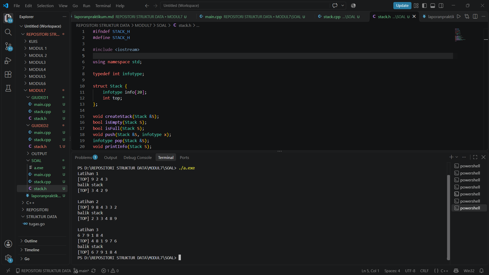

# <h1 align="center">Laporan Praktikum Modul 7 - Codeblocks IDE & Pengenalan Bahas C++ (Bagian Pertama)</h1>

<p align="center">ALIF RIZKI PANGESTU - 109082530004</p>

## Dasar Teori

### A. Konsep Stack <br>

Stack adalah struktur data yang cara kerjanya seperti tumpukan. Elemen yang bisa diambil lebih dulu adalah elemen paling atas, yaitu elemen yang terakhir dimasukkan. Prinsip ini disebut LIFO (Last In First Out).

### B. Komponen dan Deklarasi Stack <br>

Komponen stack pada dasarnya sama dengan singly linked list, yaitu elemen yang saling terhubung lewat pointer next. Bedanya, akses pada stack hanya bisa dilakukan lewat elemen paling awal yang disebut Top. Karena itu, tipe data stack hanya memiliki satu komponen, yaitu address Top.

Elemen stack dideklarasikan dengan struct elmStack yang berisi info untuk menyimpan data dan next untuk menunjuk elemen berikutnya. Tipe address adalah pointer ke elemen tersebut, sama seperti pada list lainnya. Stack dianggap kosong ketika Top bernilai Nil.

### C. Operasi Push dan Pop (Representasi Pointer) <br>

Push adalah operasi menyisipkan elemen ke tumpukan dan sama dengan insert first pada list biasa. Elemen dibuat dulu dengan alokasi lalu next-nya diisi Nil. Setelah itu next elemen diarahkan ke Top lama dan Top dipindah ke elemen baru.

Pop adalah operasi mengambil elemen paling atas dan mirip dengan delete first pada list linear. Alamat elemen Top disimpan dulu ke pointer P, lalu Top dipindah ke elemen berikutnya. Setelah itu alamat P dikembalikan sebagai elemen yang diambil.

### D. Primitif dalam Stack <br>

Primitif stack pada dasarnya sama dengan primitif pada list lainnya, tetapi jumlahnya lebih sedikit. Hal ini karena stack hanya melakukan operasi pada elemen paling atas. Primitif tersebut antara lain createStack, isEmpty, alokasi, dealokasi, dan fungsi pencarian.

Seperti pada model list yang lain, primitif stack disimpan dalam dua file. File *.h berisi deklarasi tipe data dan prototype fungsi, sedangkan file *.c berisi isi fungsinya. Pemisahan ini membuat program lebih rapi dan mudah digunakan ulang.

### E. Stack dengan Representasi Tabel <br>

Prinsip representasi tabel sama dengan representasi pointer, perbedaannya ada pada deklarasi struktur datanya. Representasi tabel memakai array berindeks sehingga jumlah tumpukan terbatas. Pada contoh, indeks maksimum adalah Imax = 10 dan stack kosong ketika Top = 0.

Operasi push pada tabel dilakukan dengan menggeser Top ke indeks berikutnya (Top = Top + 1), lalu data disimpan di indeks tersebut. Sebaliknya, pop mengambil data pada indeks Top dengan Temp = S.Info[Top], lalu Top bergeser mundur (Top = Top - 1). Data lama tidak dihapus dari array, hanya posisi Top yang berubah.

### F. ADT Stack Representasi Tabel <br>

Primitif stack representasi tabel sama dengan representasi pointer, tetapi tidak memerlukan manajemen memori. Karena itu alokasi dan dealokasi tidak dipakai. Primitif yang digunakan antara lain createStack, isEmpty, fungsi pencarian, dan primitif lainnya.

Pada contoh ADT di file stack.h, Stack berisi array info berukuran 10 dan variabel Top bertipe integer. Prosedur yang tersedia adalah createStack untuk membuat stack dengan Top = 0, push untuk menambah elemen, pop untuk mengambil elemen Top, dan viewStack untuk menampilkan isi stack. Fungsi isEmpty dipakai untuk mengecek apakah stack kosong.

### G. Penerapan pada Latihan Modul <br>

Latihan pertama membuat ADT Stack dengan array berukuran 20 untuk menyimpan integer. Prosedurnya adalah createStack, push, pop, printInfo, dan balikStack. Pada contoh main, data 3, 4, 8 di-push, lalu terjadi dua kali pop di sela push berikutnya. Setelah push 9, isi stack tampil sebagai [TOP] 9 2 4 3 dan setelah dibalik menjadi 3 4 2 9.

Latihan kedua menambahkan prosedur pushAscending agar data selalu tersimpan dalam urutan menaik dari Top. Pada contoh, input 3, 4, 8, 2, 3, 9 menghasilkan tampilan [TOP] 9 8 4 3 3 2. Setelah stack dibalik, hasilnya menjadi 2 3 3 4 8 9.

Latihan ketiga menambahkan prosedur getInputStream yang terus membaca input dari user dengan cin.get() sampai tombol enter ditekan. Setiap karakter angka yang dibaca dimasukkan ke dalam stack. Pada contoh, input 4729601 menghasilkan tampilan [TOP] 1 0 6 9 2 7 4 dan setelah dibalik menjadi 4 7 2 9 6 0 1.
## Guided

### 1. stack.h

```C++
#ifndef STACK_TABLE
#define STACK_TABLE
#include <iostream>
using namespace std;
const int MAX = 10;

struct stackTable
{
    int data[MAX];
    int top;
};
bool isEmpty(stackTable s);
bool isFull(stackTable s);
void createStack(stackTable &s);
void push(stackTable &s, int angka);
void pop(stackTable &s); 
void update(stackTable &s, int posisi);
void view(stackTable s);
void searchData(stackTable s, int data);
#endif
```


### 2. stack.cpp

```C++

#include "stack.h"
#include <iostream>
using namespace std;

bool isEmpty(stackTable s)
{
    return s.top == -1;
}
bool isFull(stackTable s)
{
    return s.top == MAX - 1;
}
void createStack(stackTable &s)
{
    s.top = -1;
}
void push(stackTable &s, int angka)
{

    if (isFull(s))
    {
        cout << "Stack penuh!" << endl;
    }
    else
    {
        s.top++;
        s.data[s.top] = angka;
        cout << "Data" << angka << "berhasil ditambahkan kedalam stack !" << endl;
    }
}

void pop(stackTable &s)
{
    if (isEmpty(s))
    {
        cout << "Stack kosong!" << endl;
    }
    else
    {
        int val = s.data[s.top];
        s.top--;
        cout << "Data" << val << " berhasil dihapus dari stack!" << endl;
    }
}

void update(stackTable &s, int posisi)
{
    if (isEmpty(s))
    {
        cout << "Stack kosong!" << endl;
    }
    if (posisi <= 0)
    {
        cout << "Posisi tidak valid!" << endl;
        return;
    }
    // index = top

    int idx = s.top - (posisi - 1);
    if (idx < 0 || idx > s.top)
    {
        cout << "Posisi " << posisi << " tidak valid!" << endl;
        return;
    }

    cout << "Update data posisi ke-" << posisi << endl;
    cout << "Masukkan angka : ";
    cin >> s.data[idx];
    cout << "Data berhasil diupdate!" << endl;
    cout << endl;
}

void view(stackTable s)
{
    if (isEmpty(s))
    {
        cout << "Stack kosong!" << endl;
    }
    else
    {
        for (int i = s.top; i >= 0; --i)
        {
            cout << s.data[i] << " ";
        }
    }
    cout << endl;
}

void searchData(stackTable s, int data)
{
    if (isEmpty(s))
    {
        cout << "Stack kosong!" << endl;
        return;
    }

    cout << "Mencari data " << data << "..." << endl;
    int posisi = 1;
    bool found = false;

    for (int i = s.top; i >= 0; --i)
    {
        if (s.data[i] == data)
        {
            cout << "Data " << data << " ditemukan pada posisi ke-" << posisi << endl;
            cout << endl;
            found = true;
            break;
        }
        posisi++;
    }

    if (!found)
    {
        cout << "Data " << data << " tidak ditemukan didalam stack!" << endl;
        cout << endl;
    }
}
```


### 3. main.cpp

```C++
#include "stack.h"
#include <iostream>

using namespace std;

int main()
{
    stackTable s;
    createStack(s);

    push(s, 1);
    push(s, 2);
    push(s, 3);
    push(s, 4);
    push(s, 5);
    cout << endl;

    cout << "--- Stack setelah push ---" << endl;
    view(s);
    cout << endl;

    pop(s);
    pop(s);
    cout << endl;

    cout << "--- Stack setelah pop 2 kali ---" << endl;
    view(s);
    cout << endl;

    update(s, 2);
    update(s, 1);
    cout << endl;

    cout << "--- Stack setelah update ---" << endl;
    view(s);
    cout << endl;

    searchData(s, 4);
    searchData(s, 9);

    return 0;
}
```
### Output guided 1 :

##### Output 1

![Screenshot Output Unguided 1_1]
Kode ini mengimplementasikan stack dengan representasi array di C++ yang dibagi menjadi tiga file. File `stack.h` berisi struct `stackTable` (array `data` berkapasitas 10 dan `top`) beserta prototype fungsi, `stack.cpp` berisi isi fungsi `push`, `pop`, `update`, `view`, dan `searchData` dengan prinsip LIFO (`top = -1` menandakan stack kosong), dan `main.cpp` menjalankan alurnya: memasukkan angka 1 sampai 5, melakukan `pop` dua kali, mengubah dua elemen lewat `update`, lalu mencari angka 4 dan 9 dengan `searchData`.

## Guided

### 1. stack.h

```C++
#include "stack.h"
#include <iostream>

using namespace std;

bool isEmpty(stack listStack)
{
    if (listStack.top == Nil)
    {
        return true;
    }
    else
    {
        return false;
    }
}

void createStack(stack &listStack)
{
    listStack.top = Nil;
}

address alokasi(int angka)
{
    address nodeBaru = new node;
    nodeBaru->dataAngka = angka;
    nodeBaru->next = Nil;
    return nodeBaru;
}

void dealokasi(address &node)
{
    node->next = Nil;
    delete node;
}

void push(stack &listStack, address nodeBaru)
{
    nodeBaru->next = listStack.top;
    listStack.top = nodeBaru;
    cout << "Node " << nodeBaru->dataAngka << " berhasil ditambahkan kedalam stack!" << endl;
}

void pop(stack &listStack)
{
    address nodeHapus;
    if (isEmpty(listStack) == true)
    {
        cout << "Stack kosong!" << endl;
    }
    else
    {
        nodeHapus = listStack.top;
        listStack.top = listStack.top->next;
        nodeHapus->next = Nil;
        dealokasi(nodeHapus);
        cout << "node " << nodeHapus->dataAngka << " berhasil dihapus dari stack!" << endl;
    }
}

void update(stack &listStack, int posisi)
{
    if (isEmpty(listStack) == true)
    {
        cout << "Stack kosong!" << endl;
    }
    else
    {
        if (posisi == 0)
        {
            cout << "Posisi tidak valid!" << endl;
        }
        else
        {
            address nodeBantu = listStack.top;
            int count = 1;
            bool found = false;
            while (nodeBantu != Nil)
            {
                if (count < posisi)
                {
                    nodeBantu = nodeBantu->next;
                    count++;
                }
                else if (count == posisi)
                {
                    cout << "Update node poisisi ke-" << posisi << endl;
                    cout << "Masukkan angka : ";
                    cin >> nodeBantu->dataAngka;
                    cout << "Data berhasil diupdate!" << endl;
                    cout << endl;
                    found = true;
                    break;
                }
            }
            if (found == false)
            {
                cout << "Posisi " << posisi << " tidak valid!" << endl;
            }
        }
    }
}

void view(stack listStack)
{
    if (isEmpty(listStack) == true)
    {
        cout << "List kosong!" << endl;
    }
    else
    {
        address nodeBantu = listStack.top;
        while (nodeBantu != Nil)
        {
            cout << nodeBantu->dataAngka << " ";
            nodeBantu = nodeBantu->next;
        }
    }
    cout << endl;
}

void searchData(stack listStack, int data)
{
    if (isEmpty(listStack) == true)
    {
        cout << "List kosong!" << endl;
    }
    else
    {
        address nodeBantu = listStack.top;
        int posisi = 1;
        bool found = false;
        cout << "Mencari data " << data << "..." << endl;
        while (nodeBantu != Nil)
        {
            if (nodeBantu->dataAngka == data)
            {
                cout << "Data " << data << " ditemukan pada posisi ke-" << posisi << endl;
                found = true;
                cout << endl;
                break;
            }
            else
            {
                posisi++;
                nodeBantu = nodeBantu->next;
            }
        }
        if (found == false)
        {
            cout << "Data " << data << " tidak ditemukan didalam stack!" << endl;
            cout << endl;
        }
    }
}
```


### 2. stack.cpp

```C++

#include "stack.h"
#include <iostream>

using namespace std;

bool isEmpty(stack listStack)
{
    if (listStack.top == Nil)
    {
        return true;
    }
    else
    {
        return false;
    }
}

void createStack(stack &listStack)
{
    listStack.top = Nil;
}

address alokasi(int angka)
{
    address nodeBaru = new node;
    nodeBaru->dataAngka = angka;
    nodeBaru->next = Nil;
    return nodeBaru;
}

void dealokasi(address &node)
{
    node->next = Nil;
    delete node;
}

void push(stack &listStack, address nodeBaru)
{
    nodeBaru->next = listStack.top;
    listStack.top = nodeBaru;
    cout << "Node " << nodeBaru->dataAngka << " berhasil ditambahkan kedalam stack!" << endl;
}

void pop(stack &listStack)
{
    address nodeHapus;
    if (isEmpty(listStack) == true)
    {
        cout << "Stack kosong!" << endl;
    }
    else
    {
        nodeHapus = listStack.top;
        listStack.top = listStack.top->next;
        nodeHapus->next = Nil;
        dealokasi(nodeHapus);
        cout << "node " << nodeHapus->dataAngka << " berhasil dihapus dari stack!" << endl;
    }
}

void update(stack &listStack, int posisi)
{
    if (isEmpty(listStack) == true)
    {
        cout << "Stack kosong!" << endl;
    }
    else
    {
        if (posisi == 0)
        {
            cout << "Posisi tidak valid!" << endl;
        }
        else
        {
            address nodeBantu = listStack.top;
            int count = 1;
            bool found = false;
            while (nodeBantu != Nil)
            {
                if (count < posisi)
                {
                    nodeBantu = nodeBantu->next;
                    count++;
                }
                else if (count == posisi)
                {
                    cout << "Update node poisisi ke-" << posisi << endl;
                    cout << "Masukkan angka : ";
                    cin >> nodeBantu->dataAngka;
                    cout << "Data berhasil diupdate!" << endl;
                    cout << endl;
                    found = true;
                    break;
                }
            }
            if (found == false)
            {
                cout << "Posisi " << posisi << " tidak valid!" << endl;
            }
        }
    }
}

void view(stack listStack)
{
    if (isEmpty(listStack) == true)
    {
        cout << "List kosong!" << endl;
    }
    else
    {
        address nodeBantu = listStack.top;
        while (nodeBantu != Nil)
        {
            cout << nodeBantu->dataAngka << " ";
            nodeBantu = nodeBantu->next;
        }
    }
    cout << endl;
}

void searchData(stack listStack, int data)
{
    if (isEmpty(listStack) == true)
    {
        cout << "List kosong!" << endl;
    }
    else
    {
        address nodeBantu = listStack.top;
        int posisi = 1;
        bool found = false;
        cout << "Mencari data " << data << "..." << endl;
        while (nodeBantu != Nil)
        {
            if (nodeBantu->dataAngka == data)
            {
                cout << "Data " << data << " ditemukan pada posisi ke-" << posisi << endl;
                found = true;
                cout << endl;
                break;
            }
            else
            {
                posisi++;
                nodeBantu = nodeBantu->next;
            }
        }
        if (found == false)
        {
            cout << "Data " << data << " tidak ditemukan didalam stack!" << endl;
            cout << endl;
        }
    }
}
```


### 3. main.cpp

```C++
#include "stack.h"
#include <iostream>

using namespace std;

int main()
{
    stack listStack;
    address nodeA, nodeB, nodeC, nodeD, nodeE = Nil;
    createStack(listStack);

    nodeA = alokasi(1);
    nodeB = alokasi(2);
    nodeC = alokasi(3);
    nodeD = alokasi(4);
    nodeE = alokasi(5);

    push(listStack, nodeA);
    push(listStack, nodeB);
    push(listStack, nodeC);
    push(listStack, nodeD);
    push(listStack, nodeE);
    cout << endl;

    cout << "--- Stack setelah push ---" << endl;
    view(listStack);
    cout << endl;

    pop(listStack);
    pop(listStack);
    cout << endl;

    cout << "--- Stack setelah pop 2 kali ---" << endl;
    view(listStack);
    cout << endl;

    update(listStack, 2);
    update(listStack, 1);
    update(listStack, 4);
    cout << endl;

    cout << "--- Stack setelah update ---" << endl;
    view(listStack);
    cout << endl;

    searchData(listStack, 4);
    searchData(listStack, 9);

    return 0;
}
```
### Output guided 1 :

##### Output 1

![Screenshot Output Unguided 1_1]
Kode ini mengimplementasikan stack dengan representasi array di C++ yang dibagi menjadi tiga file. File `stack.h` berisi struct `stackTable` (array `data` berkapasitas 10 dan `top`) beserta prototype fungsi, `stack.cpp` berisi isi fungsi `push`, `pop`, `update`, `view`, dan `searchData` dengan prinsip LIFO (`top = -1` menandakan stack kosong), dan `main.cpp` menjalankan alurnya: memasukkan angka 1 sampai 5, melakukan `pop` dua kali, mengubah dua elemen lewat `update`, lalu mencari angka 4 dan 9 dengan `searchData`.


## Unguided
## soal1

### 1. stack.h
```C++

#ifndef STACK_H
#define STACK_H

#include <iostream>

using namespace std;

typedef int infotype;

struct Stack {
    infotype info[20];
    int top;
};

void createStack(Stack &S);
bool isEmpty(Stack S);
bool isFull(Stack S);
void push(Stack &S, infotype x);
infotype pop(Stack &S);
void printInfo(Stack S);
void balikStack(Stack &S);
void pushAscending(Stack &S, infotype x);
void getInputStream(Stack &S);

#endif
```
### 2. stack.cpp

```C++
#include "stack.h"

void createStack(Stack &S) {
    S.top = -1;
}

bool isEmpty(Stack S) {
    return S.top == -1;
}

bool isFull(Stack S) {
    return S.top == 19;
}

void push(Stack &S, infotype x) {
    if (!isFull(S)) {
        S.top++;
        S.info[S.top] = x;
    }
}

infotype pop(Stack &S) {
    infotype x = -1;
    if (!isEmpty(S)) {
        x = S.info[S.top];
        S.top--;
    }
    return x;
}

void printInfo(Stack S) {
    cout << "[TOP] ";
    for (int i = S.top; i >= 0; i--) {
        cout << S.info[i] << " ";
    }
    cout << endl;
}

void balikStack(Stack &S) {
    if (!isEmpty(S)) {
        Stack temp1, temp2;
        createStack(temp1);
        createStack(temp2);

        while (!isEmpty(S)) {
            push(temp1, pop(S));
        }
        while (!isEmpty(temp1)) {
            push(temp2, pop(temp1));
        }
        while (!isEmpty(temp2)) {
            push(S, pop(temp2));
        }
    }
}

void pushAscending(Stack &S, infotype x) {
    Stack temp;
    createStack(temp);

    while (!isEmpty(S) && S.info[S.top] > x) {
        push(temp, pop(S));
    }

    push(S, x);

    while (!isEmpty(temp)) {
        push(S, pop(temp));
    }
}

void getInputStream(Stack &S) {
    char c;
    while (cin.get(c) && c != '\n') {
        if (c >= '0' && c <= '9') {
            push(S, c - '0');
        }
    }
}
```

### 3. main.cpp
```C++

#include <iostream>
#include "stack.h"

using namespace std;

int main() {
    Stack S;

    cout << "Latihan 1" << endl;
    createStack(S);
    push(S, 3);
    push(S, 4);
    push(S, 8);
    pop(S);
    push(S, 2);
    push(S, 3);
    pop(S);
    push(S, 9);
    printInfo(S);
    cout << "balik stack" << endl;
    balikStack(S);
    printInfo(S);
    cout << endl;

    cout << "Latihan 2" << endl;
    createStack(S);
    pushAscending(S, 3);
    pushAscending(S, 4);
    pushAscending(S, 8);
    pushAscending(S, 2);
    pushAscending(S, 3);
    pushAscending(S, 9);
    printInfo(S);
    cout << "balik stack" << endl;
    balikStack(S);
    printInfo(S);
    cout << endl;

    cout << "Latihan 3" << endl;
    createStack(S);
    getInputStream(S);
    printInfo(S);
    cout << "balik stack" << endl;
    balikStack(S);
    printInfo(S);

    return 0;
}

```
### Output Unguided 1 :

##### Output 1



Kode ini mengimplementasikan ADT Stack dengan representasi array di C++ untuk tiga latihan modul, yang dibagi menjadi tiga file. File stack.h mendeklarasikan struct Stack (array info berkapasitas 20 dan top) beserta prototype fungsi createStack, isEmpty, isFull, push, pop, printInfo, balikStack, pushAscending, dan getInputStream. File stack.cpp berisi isi fungsi tersebut: top = -1 menandakan stack kosong, push dan pop bekerja pada elemen teratas sesuai prinsip LIFO, balikStack membalik isi stack lewat dua stack bantu, pushAscending memindahkan elemen yang lebih besar dari x ke stack sementara sebelum menyisipkan x agar urutannya menaik, dan getInputStream membaca karakter dengan cin.get() sampai enter lalu memasukkan setiap angka ke stack. File main.cpp menjalankan ketiga latihan secara berurutan, yaitu operasi push, pop, dan balik stack (hasil [TOP] 9 2 4 3 lalu 3 4 2 9), push ascending ([TOP] 9 8 4 3 3 2 lalu 2 3 3 4 8 9), serta input stream (4729601 menjadi [TOP] 1 0 6 9 2 7 4 lalu 4 7 2 9 6 0 1). Hasil simulasi dari kode ini sama dengan contoh output pada modul.


## Kesimpulan

Stack adalah struktur data berprinsip LIFO yang operasinya hanya dilakukan pada elemen paling atas (top). Pada representasi tabel, stack memakai array berindeks sehingga kapasitasnya terbatas, tetapi tidak memerlukan alokasi dan dealokasi memori seperti representasi pointer. Dari praktikum ini, operasi dasar push dan pop dapat dikembangkan menjadi operasi lain seperti membalik stack, menyisipkan data secara terurut, dan menyimpan input pengguna, yaitu dengan memanfaatkan stack bantu. Pemisahan kode ke file .h, .cpp, dan main.cpp juga membuat program lebih rapi dan mudah digunakan ulang.

## Referensi

Fakultas Informatika, Telkom University. Modul 7 Stack, Modul Praktikum Struktur Data. Informatics Lab.
Cormen, T. H., Leiserson, C. E., Rivest, R. L., & Stein, C. (2022). Introduction to Algorithms (4th ed.). MIT Press.
Goodrich, M. T., Tamassia, R., & Mount, D. M. (2011). Data Structures and Algorithms in C++ (2nd ed.). Wiley.