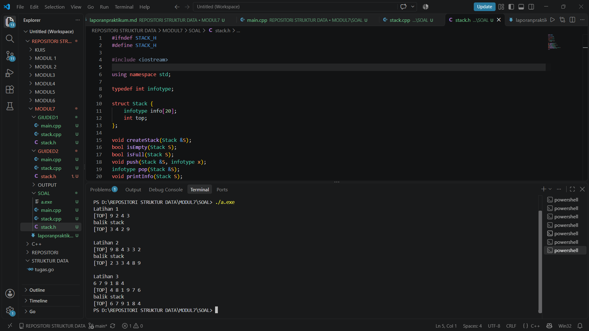

# <h1 align="center">Laporan Praktikum Modul 7 - Codeblocks IDE & Pengenalan Bahas C++ (Bagian Pertama)</h1>

<p align="center">ALIF RIZKI PANGESTU - 109082530004</p>

## Dasar Teori

## Dasar Teori

### A. Konsep Queue <br>

Queue adalah struktur data yang cara kerjanya seperti antrean, misalnya antrean di loket tiket kereta api. Elemen yang pertama masuk akan dilayani atau diambil lebih dulu, sedangkan elemen terakhir masuk akan diambil paling akhir. Prinsip ini disebut FIFO (First In First Out) dan dapat dibuat dengan array maupun linked list.

### B. Komponen dan Deklarasi Queue <br>

Queue dengan linked list mirip dengan list biasa, yaitu elemen yang saling terhubung lewat pointer next. Bedanya, queue memiliki dua komponen, yaitu Head sebagai elemen paling depan dan Tail sebagai elemen paling belakang. Elemen dideklarasikan dengan struct elmQueue yang berisi info dan next, dan queue dianggap kosong ketika Head bernilai Nil.

### C. Operasi Enqueue dan Dequeue <br>

Enqueue adalah operasi menyisipkan elemen yang selalu dilakukan di bagian Tail, mirip dengan insert last. Elemen dibuat dulu dengan alokasi dan next-nya diisi Nil, lalu next dari Tail lama diarahkan ke elemen baru dan Tail dipindah ke elemen tersebut. Dequeue adalah operasi mengambil elemen di bagian Head, yaitu Head disimpan ke pointer P, Head dipindah ke elemen berikutnya, lalu next dari P diisi Nil dan P dikembalikan.

### D. Primitif dalam Queue <br>

Primitif queue disimpan pada ADT queue dalam dua file, yaitu file *.h yang berisi deklarasi tipe data dan prototype fungsi, serta file *.c yang berisi isi fungsinya. Primitif yang tersedia antara lain isEmpty, CreateQueue, alokasi, dealokasi, findElm, insert, delete, printInfo, nbList, dan delAll. Pemisahan file ini membuat program lebih rapi dan mudah digunakan ulang.

### E. Queue dengan Representasi Tabel <br>

Prinsip representasi tabel sama dengan representasi pointer, perbedaannya ada pada jumlah antrean dan manajemen memori. Pada representasi tabel jumlah antrean terbatas dan tidak ada manajemen memori, sedangkan pada representasi pointer jumlahnya tak terbatas dan memakai manajemen memori. Karena itu, pada tabel dikenal tiga alternatif bentuk queue yang berbeda cara menggerakkan Head dan Tail.

### F. Alternatif 1 (Head Diam, Tail Bergerak) <br>

Pada alternatif 1, Head selalu bernilai 1 jika queue tidak kosong dan bernilai 0 jika queue kosong, sedangkan Tail menunjuk indeks elemen terakhir. Penambahan elemen dilakukan dengan memajukan Tail, sedangkan penghapusan dilakukan dengan mengambil elemen Head lalu menggeser semua elemen sesudahnya dan memundurkan Tail. Algoritma ini mencerminkan orang yang bergeser saat mengantre di dunia nyata, tetapi tidak efisien karena ada pergeseran elemen.

### G. Alternatif 2 (Head Bergerak, Tail Bergerak) <br>

Pada alternatif 2, Head ikut bergerak maju ketika sebuah elemen dihapus, sehingga tidak perlu menggeser elemen seperti pada alternatif 1. Penambahan elemen sama seperti alternatif 1, yaitu memajukan Tail, dengan kasus khusus saat queue kosong karena Head harus diset menjadi 1. Algoritma ini lebih efisien, tetapi dapat terjadi kondisi penuh semu, sehingga elemen harus digeser hanya ketika Tail sudah mencapai indeks maksimum.

### H. Alternatif 3 (Head dan Tail Berputar) <br>

Pada alternatif 3, Head dan Tail berputar mengelilingi indeks tabel dari awal sampai akhir lalu kembali ke awal, sehingga disebut circular buffer. Jika Tail atau Head sudah mencapai indeks maksimum, maka successor-nya adalah indeks 1, dan queue kosong ditandai dengan Head = 0. Cara ini efisien karena tidak ada pergeseran elemen, dan salah satu variasinya adalah mengganti Tail dengan COUNT sebagai banyaknya elemen.

### I. ADT Queue Representasi Tabel <br>

Primitif queue representasi tabel sama dengan representasi pointer, tetapi tidak memerlukan alokasi dan dealokasi. Pada contoh ADT di file queue.h, Queue berisi array info berukuran 3 serta variabel head dan tail bertipe integer. Prosedur yang tersedia adalah CreateQueue untuk membuat queue dengan head = -1 dan tail = -1, enQueue untuk menambah elemen, deQueue untuk menghapus elemen, dan viewQueue untuk menampilkan isi queue, serta fungsi isFull dan isEmpty untuk pengecekan.

### J. Penerapan pada Latihan Modul <br>

Latihan pertama membuat ADT Queue dengan array berukuran 5 untuk menyimpan integer, dengan prosedur createQueue, enqueue, dequeue, printInfo, serta fungsi isEmptyQueue dan isFullQueue. Implementasi pada queue.cpp memakai mekanisme alternatif 1 (head diam, tail bergerak), dan main menampilkan nilai head, tail, serta isi queue setiap kali enqueue dan dequeue dilakukan. Latihan kedua dan ketiga mengerjakan hal yang sama dengan mekanisme alternatif 2 (head bergerak, tail bergerak) dan alternatif 3 (head dan tail berputar).

## Guided 1

### 1. queue.h

```C++
#ifndef QUEUE_H
#define QUEUE_H

#include <iostream>
#include <string>
using namespace std;

struct Node {
    string nama;
    Node *next;
};

struct queue {
    Node *head, *tail;
};

void CreateQueue(queue &Q);
bool isEmpty(queue Q);
bool isFull(queue Q);
void enQueue(queue &Q, const string &nama);
void deQueue(queue &Q);
void viewQueue(queue Q);
void clearQueue(queue &Q);
#endif
```


### 2. queue.cpp

```C++

#include "queue.h"

void CreateQueue(queue &Q) {
    Q.head = Q.tail = nullptr;
}

bool isEmpty(queue Q) {
    return Q.head == nullptr;
}

bool isFull(queue Q) {
    int maxQueue = 20;
    int counter = 0;
    Node *nodeBantu = Q.head;
    while (nodeBantu != Q.tail) {
        counter++;
        nodeBantu = nodeBantu->next;
    }
    return counter >= maxQueue;
}

void enQueue(queue &Q, const string &nama) {
    if (isEmpty(Q)) {
        Node *nodeBaru = new Node(nama, nullptr);
        Q.head = Q.tail = nodeBaru;
    } else {
        Node *nodeBaru = new Node(nama, nullptr);
        Q.tail->next = nodeBaru;
        Q.tail = nodeBaru;
    }
}

void deQueue(queue &Q) {
    if (isEmpty(Q)) {
        cout << "Queue kosong";
    } else {
        Node *nodeHapus = Q.head;
        Q.head = Q.head->next;
        delete nodeHapus;
    }
}

void viewQueue(queue Q) {
    if (isEmpty(Q)) {
        cout << "Queue kosong";
    } else {
        Node *nodeBantu = Q.head;
        while (nodeBantu != nullptr) {
            cout << "Nama : " << nodeBantu->nama;
            nodeBantu = nodeBantu->next;
        }
    }
}


void clearQueue(queue &Q) {
    if (!isEmpty(Q)) {
        cout << "Queue kosong";
    }else{
        Node *nodeHapus = Q.head;
        while (nodeHapus != nullptr) {
            nodeHapus = nodeHapus->next;
            deQueue(Q);
        }
    }
}
```


### 3. main.cpp

```C++
#include "queue.h"
#include <iostream>
using namespace std;

int main() {
    queue Q;
    CreateQueue(Q);

    enQueue(Q, "Gilar");
    enQueue(Q, "Aflah");
    enQueue(Q, "Aedil");
    enQueue(Q, "Fathir");
    enQueue(Q, "Kevin");
    enQueue(Q, "Zulfa");
    cout << endl;

    cout << "--- Isi Queue Setelah enQueue ---" << endl;
    viewQueue(Q);

    clearQueue(Q);
    return 0;
}
```
### Output guided 1 :

##### Output 1

![Screenshot Output Unguided 1_1]
Program ini mengimplementasikan queue dengan linked list yang terdiri dari tiga file. File `queue.h` berisi deklarasi struct `Node`, struct `queue` (berisi `head` dan `tail`), serta prototype fungsi, sedangkan `queue.cpp` berisi isi fungsi untuk membuat queue kosong, mengecek kosong atau penuh, menambah elemen di belakang (`enQueue`), menghapus elemen di depan (`deQueue`), menampilkan isi, dan mengosongkan queue sesuai prinsip FIFO. File `main.cpp` menguji semuanya dengan memasukkan enam nama (Gilar, Aflah, Aedil, Fathir, Kevin, dan Zulfa), menampilkan isi queue dengan `viewQueue`, lalu mengosongkannya dengan `clearQueue`.

## Guided 2

### 1. queue.h

```C++
#ifndef QUEUE_H
#define QUEUE_H

#include <iostream>
#include <string>
using namespace std;

const int MAX = 5;

struct queue {
    string nama[MAX];
    int head;
    int tail;
};

bool isEmpty(queue Q);
bool isFull(queue Q);
void createQueue(queue &Q);
void enQueue(queue &Q, string nama);
void deQueue(queue &Q);
void viewQueue(queue Q);

#endif
```


### 2. queue.cpp

```C++

#include "queue.h"
#include <iostream>

using namespace std;

// NOTE : 
// Implementasi 1 = head diam, tail bergerak (Queue Linear Statis, kerana head nya tetap diam)
// Implementasi 2 = head bergerak, tail bergerak (Queue Linear Dinamis, karena head & tail nya sama-sama bergerak)
// Implementasi 3 = head dan tail berputar (Queue Circular, karena jika udh mentok tapi masih ada space, diputar sehingga tail bisa ada didepan head)

bool isEmpty(queue Q){
    if(Q.head == -1 && Q.tail == -1){
        return true;
    } else {
        return false;
    }
}

//isFull implmenetasi 1 & 2
bool isFull(queue Q){
    if(Q.tail == MAKSIMAL - 1){
        return true;
    } else {
        return false;
    }
}

//isFull implementasi 3
// bool isFull(queue Q){
//     if((Q.tail + 1) % MAKSIMAL == Q.head){
//         return true;
//     } else {
//         return false;
//     }
// }

void CreateQueue(queue &Q){ //terbentuk queue dengan head = -1 dan tail = -1 
    Q.head = -1;
    Q.tail = -1;
}
 

//enqueue implementasi 1 & 2
void enQueue(queue &Q, string nama){
    if(isFull(Q) == true){
        cout << "Queue sudah penuh!" << endl;
    } else {
        if(isEmpty(Q) == true){
            Q.head = Q.tail = 0;
        } else {
            Q.tail++;
        }
        Q.nama[Q.tail] = nama;
        cout << "nama " << nama << " berhasil ditambahkan kedalam queue!" << endl;
    }
}

// //enQueue implementasi 3
// void enQueue(queue &Q, string nama){
//     if(isFull(Q) == true){
//         cout << "Queue sudah penuh!" << endl;
//     } else {
//         if(isEmpty(Q) == true){
//             Q.head = Q.tail = 0;
//         } else {
//             Q.tail = (Q.tail + 1) % MAKSIMAL; // bergerak melingkar
//         }
//         Q.nama[Q.tail] = nama;
//         cout << "nama " << nama << " berhasil ditambahkan kedalam queue!" << endl;
//     }
// }

//dequeue implementasi 1
void deQueue(queue &Q){
    if(isEmpty(Q) == true){
        cout << "Queue kosong!" << endl;
    } else {
        cout << "Mengahapus data " << Q.nama[Q.head] << "..." << endl;
        for(int i = 0; i < Q.tail; i++){
            Q.nama[i] =  Q.nama[i+1];
        }
        Q.tail--;
        if(Q.tail < 0){ //kalo semua isi queue nya udh dikeluarin, set head & tail ke -1
            Q.head = -1;
            Q.tail = -1;
        }
    }
}

// //dequeue implementasi 2
// void deQueue(queue &Q){
//     if(isEmpty(Q) == true){
//         cout << "Queue kosong!" << endl;
//     } else {
//         cout << "Mengahapus data " << Q.nama[Q.head] << "..." << endl;
//         Q.head++;
//         if(Q.head > Q.tail){ //kalo elemennya udh abis (head akan lebih 1 dari tail), maka reset ulang head & tail ke -1
//             Q.head = -1;
//             Q.tail = -1;
//         }
//     }
// }

// //deQueue implementasi 3
// void deQueue(queue &Q){
//     if(isEmpty(Q) == true){
//         cout << "Queue kosong!" << endl;
//     } else {
//         cout << "Mengahapus data " << Q.nama[Q.head] << "..." << endl;
//         if(Q.head == Q.tail){ //kalo elemennya tinggal 1, langsungkan saja head & tail nya reset ke -1
//             Q.head = -1;
//             Q.tail = -1;
//         } else {
//             Q.head = (Q.head + 1) % MAKSIMAL; // bergerak melingkar
//         }
//     }
// }

//viewQueue implementasi 1 & 2
void viewQueue(queue Q){
    if(isEmpty(Q) == true){
        cout << "Queue kosong!" << endl;
    } else {
        for(int i = Q.head; i <= Q.tail; i++){
            cout << i -  Q.head + 1 << ". " << Q.nama[i] << endl;
        }
    }
    cout << endl;
}

// //viewQueue implementasi 3
// void viewQueue(queue Q){
//     if(isEmpty(Q) == true){
//         cout << "Queue kosong!" << endl;
//     } else {
//         int i = Q.head;
//         int count = 1;
//         while(true){
//             cout << count << ". " << Q.nama[i] << endl;
//             if(i == Q.tail){
//                 break;
//             }
//             i = (i + 1) % MAKSIMAL;
//             count++;
//         }   
//     }
// }
```


### 3. main.cpp

```C++
#include "queue.h"
#include <iostream>

using namespace std;

int main(){
    queue Q;

    CreateQueue(Q);
    enQueue(Q, "Dimas");
    enQueue(Q, "Arvin");
    enQueue(Q, "Rizal");
    enQueue(Q, "Hafizh");
    enQueue(Q, "Fathur");
    enQueue(Q, "Daffa");
    cout << endl;

    cout << "--- Isi Queue Setelah enQueue ---" << endl;
    viewQueue(Q);
    cout << endl;

    deQueue(Q);
    deQueue(Q);
    deQueue(Q);
    deQueue(Q);
    // deQueue(Q);
    // deQueue(Q);
    cout << endl;

    cout << "--- Isi Queue Setelah deQueue ---" << endl;
    viewQueue(Q);

    return 0;
}
```
### Output guided 2 :

##### Output 1

![Screenshot Output Unguided 1_1]
Program ini mengimplementasikan queue dengan array berukuran `MAX` = 5 yang menyimpan `nama`, serta variabel `head` dan `tail` yang bernilai -1 saat queue kosong. File `queue.h` berisi deklarasi struct dan prototype fungsi, sedangkan `queue.cpp` berisi tiga mekanisme queue, yaitu implementasi 1 (head diam, tail bergerak, elemen digeser saat `deQueue`), implementasi 2 (head dan tail bergerak), dan implementasi 3 (head dan tail berputar seperti circular buffer). File `main.cpp` menguji queue dengan memasukkan enam nama (Dimas, Arvin, Rizal, Hafizh, Fathur, dan Daffa), menampilkannya dengan `viewQueue`, menghapus empat elemen dengan `deQueue`, lalu menampilkan isi queue yang tersisa.


## Unguided
## soal1

### 1. queue.h
```C++

#ifndef QUEUE_H
#define QUEUE_H

#include <iostream>

using namespace std;

typedef int infotype;

struct Queue {
    infotype info[5];
    int head;
    int tail;
};

void createQueue(Queue &Q);
bool isEmptyQueue(Queue Q);

bool isFullQueueAlt1(Queue Q);
void enqueueAlt1(Queue &Q, infotype x);
infotype dequeueAlt1(Queue &Q);
void printInfoAlt1(Queue Q);

bool isFullQueueAlt2(Queue Q);
void enqueueAlt2(Queue &Q, infotype x);
infotype dequeueAlt2(Queue &Q);
void printInfoAlt2(Queue Q);

bool isFullQueueAlt3(Queue Q);
void enqueueAlt3(Queue &Q, infotype x);
infotype dequeueAlt3(Queue &Q);
void printInfoAlt3(Queue Q);

#endif
```
### 2. queue.cpp

```C++
#include "queue.h"

void createQueue(Queue &Q) {
    Q.head = -1;
    Q.tail = -1;
}

bool isEmptyQueue(Queue Q) {
    return (Q.head == -1 && Q.tail == -1);
}

bool isFullQueueAlt1(Queue Q) {
    return (Q.tail == 4);
}

void enqueueAlt1(Queue &Q, infotype x) {
    if (!isFullQueueAlt1(Q)) {
        if (isEmptyQueue(Q)) {
            Q.head = 0;
            Q.tail = 0;
            Q.info[0] = x;
        } else {
            Q.tail++;
            Q.info[Q.tail] = x;
        }
    }
}

infotype dequeueAlt1(Queue &Q) {
    infotype x = -1;
    if (!isEmptyQueue(Q)) {
        x = Q.info[Q.head];
        if (Q.head == Q.tail) {
            Q.head = -1;
            Q.tail = -1;
        } else {
            for (int i = Q.head; i < Q.tail; i++) {
                Q.info[i] = Q.info[i + 1];
            }
            Q.tail--;
        }
    }
    return x;
}

void printInfoAlt1(Queue Q) {
    if (isEmptyQueue(Q)) {
        cout << Q.head << " - " << Q.tail << " | empty queue" << endl;
    } else {
        cout << Q.head << " - " << Q.tail << "   | ";
        for (int i = Q.head; i <= Q.tail; i++) {
            cout << Q.info[i] << " ";
        }
        cout << endl;
    }
}

bool isFullQueueAlt2(Queue Q) {
    return (Q.head == 0 && Q.tail == 4);
}

void enqueueAlt2(Queue &Q, infotype x) {
    if (!isFullQueueAlt2(Q)) {
        if (isEmptyQueue(Q)) {
            Q.head = 0;
            Q.tail = 0;
            Q.info[0] = x;
        } else {
            if (Q.tail == 4) {
                int j = 0;
                for (int i = Q.head; i <= Q.tail; i++) {
                    Q.info[j] = Q.info[i];
                    j++;
                }
                Q.tail = Q.tail - Q.head;
                Q.head = 0;
            }
            Q.tail++;
            Q.info[Q.tail] = x;
        }
    }
}

infotype dequeueAlt2(Queue &Q) {
    infotype x = -1;
    if (!isEmptyQueue(Q)) {
        x = Q.info[Q.head];
        if (Q.head == Q.tail) {
            Q.head = -1;
            Q.tail = -1;
        } else {
            Q.head++;
        }
    }
    return x;
}

void printInfoAlt2(Queue Q) {
    if (isEmptyQueue(Q)) {
        cout << Q.head << " - " << Q.tail << " | empty queue" << endl;
    } else {
        cout << Q.head << " - " << Q.tail << "   | ";
        for (int i = Q.head; i <= Q.tail; i++) {
            cout << Q.info[i] << " ";
        }
        cout << endl;
    }
}

bool isFullQueueAlt3(Queue Q) {
    return ((Q.tail + 1) % 5 == Q.head);
}

void enqueueAlt3(Queue &Q, infotype x) {
    if (!isFullQueueAlt3(Q)) {
        if (isEmptyQueue(Q)) {
            Q.head = 0;
            Q.tail = 0;
            Q.info[0] = x;
        } else {
            Q.tail = (Q.tail + 1) % 5;
            Q.info[Q.tail] = x;
        }
    }
}

infotype dequeueAlt3(Queue &Q) {
    infotype x = -1;
    if (!isEmptyQueue(Q)) {
        x = Q.info[Q.head];
        if (Q.head == Q.tail) {
            Q.head = -1;
            Q.tail = -1;
        } else {
            Q.head = (Q.head + 1) % 5;
        }
    }
    return x;
}

void printInfoAlt3(Queue Q) {
    if (isEmptyQueue(Q)) {
        cout << Q.head << " - " << Q.tail << " | empty queue" << endl;
    } else {
        cout << Q.head << " - " << Q.tail << "   | ";
        int i = Q.head;
        while (true) {
            cout << Q.info[i] << " ";
            if (i == Q.tail) {
                break;
            }
            i = (i + 1) % 5;
        }
        cout << endl;
    }
}
```

### 3. main.cpp
```C++

#include <iostream>
#include "queue.h"

using namespace std;

int main() {
    Queue Q;

    cout << "=== ALTERNATIF 1 ===" << endl;
    createQueue(Q);
    printInfoAlt1(Q);
    enqueueAlt1(Q, 5); printInfoAlt1(Q);
    enqueueAlt1(Q, 2); printInfoAlt1(Q);
    enqueueAlt1(Q, 7); printInfoAlt1(Q);
    dequeueAlt1(Q); printInfoAlt1(Q);
    dequeueAlt1(Q); printInfoAlt1(Q);
    enqueueAlt1(Q, 4); printInfoAlt1(Q);
    dequeueAlt1(Q); printInfoAlt1(Q);
    dequeueAlt1(Q); printInfoAlt1(Q);
    cout << endl;

    cout << "=== ALTERNATIF 2 ===" << endl;
    createQueue(Q);
    printInfoAlt2(Q);
    enqueueAlt2(Q, 5); printInfoAlt2(Q);
    enqueueAlt2(Q, 2); printInfoAlt2(Q);
    enqueueAlt2(Q, 7); printInfoAlt2(Q);
    dequeueAlt2(Q); printInfoAlt2(Q);
    dequeueAlt2(Q); printInfoAlt2(Q);
    enqueueAlt2(Q, 4); printInfoAlt2(Q);
    dequeueAlt2(Q); printInfoAlt2(Q);
    dequeueAlt2(Q); printInfoAlt2(Q);
    cout << endl;

    cout << "=== ALTERNATIF 3 ===" << endl;
    createQueue(Q);
    printInfoAlt3(Q);
    enqueueAlt3(Q, 5); printInfoAlt3(Q);
    enqueueAlt3(Q, 2); printInfoAlt3(Q);
    enqueueAlt3(Q, 7); printInfoAlt3(Q);
    dequeueAlt3(Q); printInfoAlt3(Q);
    dequeueAlt3(Q); printInfoAlt3(Q);
    enqueueAlt3(Q, 4); printInfoAlt3(Q);
    dequeueAlt3(Q); printInfoAlt3(Q);
    dequeueAlt3(Q); printInfoAlt3(Q);

    return 0;
}

```
### Output Unguided 1 :

##### Output 1



Kode ini adalah implementasi Queue (antrian) berbasis array berukuran 5 elemen dalam C++ yang dibagi menjadi tiga file: queue.h untuk deklarasi, queue.cpp untuk isi fungsi, dan main.cpp untuk pengujian. Ada tiga alternatif cara kerja: Alternatif 1 menggeser semua elemen ke depan setiap kali dequeue sehingga head selalu di indeks 0, Alternatif 2 hanya menaikkan head saat dequeue dan baru menggeser elemen ketika tail sudah di indeks terakhir, sedangkan Alternatif 3 memakai circular queue dengan modulo (% 5) tanpa perlu menggeser elemen. Ketiganya diuji dengan urutan operasi yang sama di main.cpp, lalu hasilnya ditampilkan lewat printInfo supaya perbedaan perilaku head dan tail di tiap alternatif terlihat jelas.


## Kesimpulan

Queue adalah struktur data dengan prinsip FIFO (First In First Out), yaitu penyisipan elemen dilakukan di bagian Tail dan penghapusan elemen dilakukan di bagian Head. Queue dapat direpresentasikan dengan pointer yang jumlahnya tak terbatas dan memakai manajemen memori, atau dengan tabel (array) yang jumlahnya terbatas dan tanpa manajemen memori. Pada representasi tabel, alternatif 1 sederhana tetapi tidak efisien karena elemen harus digeser, alternatif 2 lebih efisien tetapi bisa mengalami kondisi penuh semu, dan alternatif 3 (circular) paling efisien karena Head dan Tail berputar tanpa pergeseran elemen.

## Referensi

Modul 8 Queue, Praktikum Struktur Data, Fakultas Informatika, Telkom University, hlm. 66-75.
Cormen, T. H., Leiserson, C. E., Rivest, R. L., & Stein, C. (2022). Introduction to Algorithms (4th ed.). MIT Press.
Tenenbaum, A. M., Langsam, Y., & Augenstein, M. J. (1990). Data Structures Using C. Prentice Hall.
Weiss, M. A. (2014). Data Structures and Algorithm Analysis in C++ (4th ed.). Pearson.
Goodrich, M. T., Tamassia, R., & Mount, D. M. (2011). Data Structures and Algorithms in C++ (2nd ed.). Wiley.